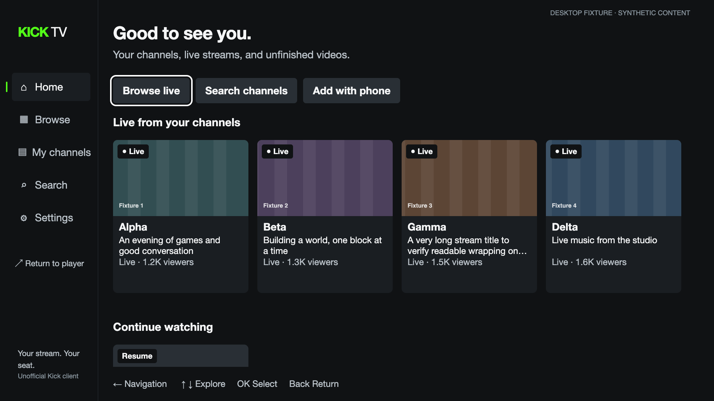
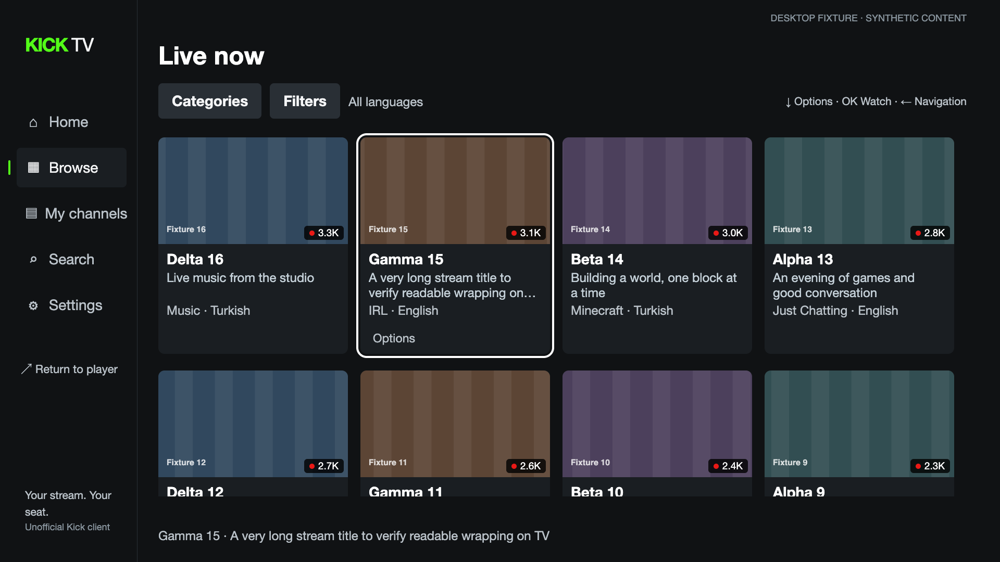
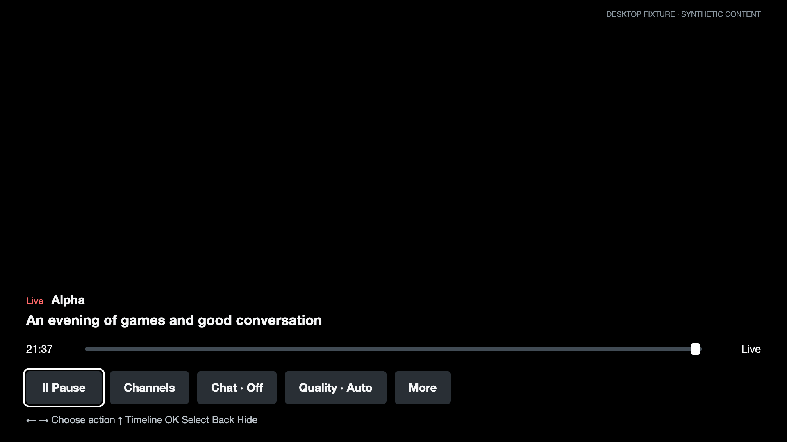
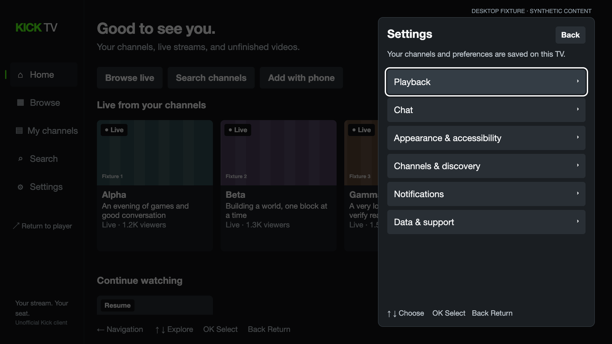

# Kick TV (Unofficial) for LG webOS

Watch Kick livestreams and recordings on an LG webOS TV, using arrows, OK,
and Back. This fork redesigns the interface for a basic TV remote: a real Home
screen, saved channels, Continue watching, consistent player controls, grouped
settings, and remote-friendly chat layouts. No sign-in is required.

The redesign is on the [`tv-ux-redesign`](../../tree/tv-ux-redesign) branch.
It builds on [barisahmet/kick-tv-webos](https://github.com/barisahmet/kick-tv-webos)
and retains its playback engine, bundled service, local data, and MIT license.
Physical LG TV validation of the redesign is still pending; desktop fixtures
cannot verify hardware video composition or real remote latency.

This is an unofficial personal project. It is not affiliated with or endorsed by
Kick, and it reads Kick's public web endpoints, so it can break if Kick changes
something. Use it at your own risk.

## Screenshots

These captures show the redesigned interface running in the isolated desktop
fixture. Channel names, artwork, counts, and chat messages are synthetic.
The player capture uses no video source.

| Home | Browse |
| --- | --- |
|  |  |
| Player | Settings |
|  |  |

The original screenshots remain in `screenshots/` for reference. Actual webOS
video plays on a separate hardware layer and may not appear in TV captures.

## Install

LG does not allow apps like this in the Content Store, so you sideload it in
Developer Mode.

### 1. Turn on Developer Mode

1. Make a free account at https://developer.lge.com. You sign in with it on the
   TV too.
2. On the TV, install "Developer Mode" from the Content Store, open it, and sign
   in.
3. Turn on Dev Mode Status and let the TV restart.
4. Open Developer Mode again. Note the TV's IP address, and turn on Key Server to
   get a short passphrase.

Developer Mode turns off after about 50 hours. Turn on auto renew if you want it
to stay on. If it expires, your sideloaded apps disappear, so just enable it
again and reinstall.

### 2. Install the app

The easy way, no command line: download the latest `.ipk` from the
[Releases](../../releases) page and install it with
[webOS Dev Manager](https://github.com/webosbrew/dev-manager-desktop), a point
and click tool. Add your TV with its IP and passphrase from step 1, then install
the file.

Prefer the command line, or want to build it yourself? You need Node.js and the
webOS CLI:

```
npm install -g @webos-tools/cli
ares-setup-device --add tv --info "host=YOUR_TV_IP" --info "port=9922" --info "username=prisoner"
ares-package ./app ./services/com.barisahmet.kicktv.service -o .
ares-install --device tv com.barisahmet.kicktv_1.0.0_all.ipk
```

Launch it from the TV home screen, or with
`ares-launch --device tv com.barisahmet.kicktv`.

If the install fails with `isDate is not a function`, that is a known bug in the
webOS CLI on recent Node.js versions, not your setup. Either use webOS Dev
Manager instead, or preload a tiny shim:

```
// shim.js
const util = require('util');
if (!util.isDate) util.isDate = (d) => Object.prototype.toString.call(d) === '[object Date]';
```

```
NODE_OPTIONS="--require ./shim.js" ares-install --device tv com.barisahmet.kicktv_1.0.0_all.ipk
```

## Using it

Everything essential works with **arrows, OK, and Back**. Colored buttons,
transport keys, and the Magic Remote pointer are optional shortcuts.

- **Home:** browse live saved channels, resume recordings, search, or add channels
  with your phone. Saved channels and progress stay on this TV.
- **Navigation:** Left from the first content column enters the labeled navigation.
  Up/Down chooses a destination; OK opens it. Right returns to content.
- **Cards:** OK watches. Down enters the focused card’s Options button; OK opens
  channel details, Save/Remove, Pin/Unpin, or recording actions. Down again moves
  to the next content row. Removing a channel offers Undo and keeps its video playing.
- **Browse:** Up from the first row reaches Categories and Filters. Filters are
  drafts until Apply; Back cancels. Clear all filters recovers an empty result.
  Categories also offer pin/block actions through Options.
- **Player:** the first OK or arrow press reveals controls without pausing.
  Left/Right chooses Play/Pause, Channels, Chat, Quality, More, and Go live when
  applicable. Up enters the timeline when the media exposes a seekable window.
  Left/Right previews a seek; OK applies it, and Back cancels it.
- **Channels:** Up/Down chooses a channel, OK watches it, and Right opens its
  options. Back closes the drawer. Opening Channels does not shrink the picture.
- **Back:** closes one visible layer, hides player controls, then returns to the
  browsing screen and item that started playback. At Home, Back offers Exit/Stay,
  with Stay selected. Stop ends playback and returns Home.
- **Chat:** More → Chat options offers Off, Right panel, Left panel, or Overlay;
  width, text, and background presets; and advanced controls. Choices are saved
  per streamer. Read chat uses Up/Down to scroll, OK to jump to live, and Back to
  finish reading. Left/Right selects Jump to live or Done. Chat is read-only.
- **Settings:** More → Quick settings offers quality, chat layout, sleep timer,
  and night mode. All settings groups playback, appearance, discovery,
  notifications, and data/support. Explicit panels stay open until dismissed.
- **Text size:** Settings → Appearance & accessibility → Text size changes useful
  UI text and uses three catalog columns in Large instead of four.
- **Startup:** new installs open Home. Existing installs preserve Resume last
  watched; change it under Settings → Playback → Open app to. The shell stays
  interactive while loading, and late startup responses cannot interrupt navigation.
- **Phone entry:** Home or Search → Add with phone reuses the local transfer
  server. Scan its QR code from a phone on the same network. Backup and restore
  remain available under Data & support. Use a trusted home network: this local
  HTTP transfer is not encrypted. Sharing closes when you leave the app;
  reopening creates a new pairing token.

Optional shortcuts: Red opens Quick settings; Green toggles chat; Yellow opens
past videos for the current channel; Blue opens Browse; 0 toggles night dimming.
Channel +/- opens and steps through the Channels drawer. The sleep timer warning
still accepts any button to keep watching. Screen protection dims idle or paused
content and static screens; the first button wakes it without activating a control.

## How it works

A webOS page cannot call kick.com directly, and Kick blocks the TV's default
requests. So the app includes a small background service that fetches Kick's
data for it and hands the stream to the TV's player. It is bundled in the same
package, nothing to set up.

## Local checks

These checks use synthetic channels and storage. They do not connect to a TV.

```
node --test tests/*.test.js
node tests/run-browser.js
```

The browser runner uses a new headless Chrome profile, blocks external requests,
and prints a temporary directory containing results and screenshots. Set
`CHROME_PATH` if Chrome is installed somewhere other than the default macOS path.

The automated compatibility floor is ES5 JavaScript and Chromium 87 CSS
(the original project’s webOS 22 target). No new browser runtime dependencies
are required. `tests/run-browser.js tv tvjourneys boot tvvisual` runs the new
remote journeys, real startup fixture, and design captures; the default command
also runs the retained streaming, chat, backup, and catalog regression suites.

See [the implementation notes](docs/TV-IMPLEMENTATION.md) for validation and
remaining physical-device checks, and [the design system](design.md) for UI rules.

## License

MIT, see LICENSE. The license covers this project's original source code only. It
does not grant any rights to third-party trademarks (see the note at the top) or to
bundled third-party software: the app bundles hls.js, which has its own license (see
THIRD_PARTY_LICENSES.md).
